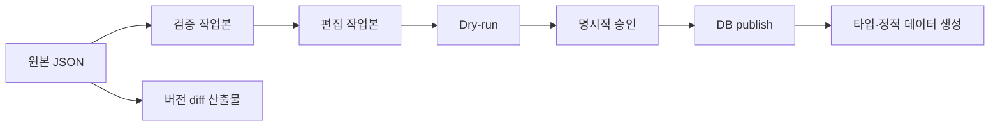
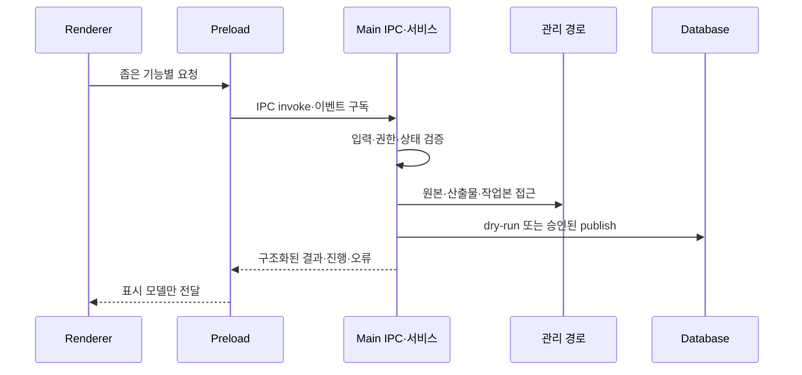

# Maple Insight Data Studio 아키텍처

- 상태: 초안
- 작성일: 2026-10-14
- 범위: Phase 3~6의 버전 비교, 도메인 작업본, DB 반영, 생성

## 1. 개요

이 문서는 원본 게임 데이터를 불변으로 보존한 채 버전 diff, 직업·스킬·장비 보강, DB 반영과 생성 작업을 분리하는 목표 구조를 정의한다. 현재 main/preload/renderer 경계와 Phase 2 validation 작업본은 존재한다. 아래 Phase 3 이후 구조와 DB 확장은 설계 제안이며 구현 상태를 뜻하지 않는다.

## 2. 데이터 경계와 흐름

- 원본: `data/<environment>/<version>/json`의 변환 JSON이다. 읽기 전용이며 수정·정규화·보강 결과를 기록하지 않는다.
- diff 산출물: `data/diff/<baseVersion>_to_<compareVersion>/<filename>`에 저장한다. 최상위 키는 `baseVersion`, `compareVersion`, `add`, `modify`, `delete`다. 두 버전과 파일명을 포함한 경로가 같은 요청의 식별자다.
- 검증 작업본: Phase 2의 `data/.workspaces/<environment>/<version>`이다. 검증 report와 manifest를 포함하며 원본과 별개다.
- 편집 작업본: validation workspace에서 파생한 versioned change-set 영속 영역이다. `data/.edit-workbenches/<environment>/<version>/<changeSetId>/`에 저장하며 DB publish 전까지 DB와 원본을 변경하지 않는다.
- DB: 명시적 승인 뒤 publish한 버전 데이터의 최종 소유자다.

각 단계는 입력 파일 해시, 버전, 실행 시각, 실행자 로컬 세션 식별자, 처리 건수와 오류 요약을 작업 이력에 남긴다. 비밀값, 전체 스크린샷 원본, 외부 서비스 인증 정보는 이력에 저장하지 않는다.

## 3. 프로세스 경계

Renderer는 Node.js, 파일 시스템, Prisma, 원시 DB 연결과 임의 경로를 사용하지 않는다. Preload는 파일 선택, 비교 실행, 편집 작업본 저장, dry-run, 승인된 publish, 생성처럼 기능별 최소 API만 노출한다. Main은 모든 IPC 입력의 버전 형식, 파일명 allowlist, ID, 페이지 범위, 승인 토큰, 수식 길이를 런타임 검증한다.

관리 경로는 `resolve` 후 허용 루트 내부인지 확인하고 심볼릭 링크를 따라가지 않는다. diff 파일명은 Phase 3의 공통 파일 allowlist만 받으며 경로 구분자, 상위 경로, 절대 경로를 거부한다. 취소·실패는 자기 실행의 staging만 삭제한다.

## 4. 버전 diff 설계

사용자는 기준 버전과 대상 버전, 공통 파일명 하나를 고른다. UI는 좌측에 추가·수정, 우측에 삭제 패널을 표시한다. 수정 레코드는 필드별 이전 값과 이후 값을 함께 표시한다. 기준 버전은 산출물의 `baseVersion`, 변경된 대상 버전은 `compareVersion`으로 기록한다. 기존 UI에서 이름이 **비교 버전**인 선택기는 기준(`baseVersion`)이고 **현재 버전** 선택기는 대상(`compareVersion`)이다. 두 선택기의 역할과 산출물 필드명을 화면에 명시한다.

초기 공통 파일은 다음 다섯 개다.

- `ms_job.json`
- `ms_skill.json`
- `ms_skillH.json`
- `ms_skillCommon.json`
- `ms_skillLevel.json`

`ms_skillPVPCommon.json`은 이 흐름의 입력과 산출물에서 제외한다.

파일별 identity는 명시적 registry로 관리한다. `ms_job.json`은 `jobID`, `ms_skill.json`과 `ms_skillH.json`은 `skillID`, `ms_skillCommon.json`은 `(skillID, commonName)`, `ms_skillLevel.json`은 `(skillID, level)`을 사용한다. identity가 누락된 레코드는 오류로 기록하고 비교하지 않는다. 같은 identity가 한 파일에 둘 이상이면 오류로 기록하고 해당 identity의 add/modify/delete를 만들지 않는다. 한쪽 버전에 파일이 없으면 오류와 누락 파일 정보를 반환하며 빈 배열로 추정하지 않는다. 배열 순서는 비교하지 않는다.

산출물의 `add`와 `delete`는 identity와 전체 레코드를, `modify`는 identity와 변경 필드별 before/after를 가진다. identity 필드 자체 변경은 delete와 add로 표현한다. 같은 입력 해시와 동일 버전·파일 요청은 기존 산출물을 재사용할 수 있고, 입력 해시가 다르면 명시적 교체 승인이 필요하다.

## 5. 도메인 편집 작업본

### 저장 계약과 lifecycle

edit workbench 하나는 변경 집합 하나다. `changeSetId`는 UUID로 한 번 생성하고 바꾸지 않는다. 디렉터리는 `manifest.json`, 도메인별 append-only record 파일, `dry-run.json`, `approval.json`, `runs/` 하위 실행 결과만 가진다. 이미지 바이트와 임의의 원본 경로는 저장하지 않는다.

manifest는 `schemaVersion`, `changeSetId`, environment, version, validation workspace manifest hash, raw input hash, 상태, 생성·수정 시각, 생성자 로컬 식별자, parentChangeSetId, canonical change-set hash를 가진다. 레코드는 `recordId`, domain, operation, 원시 identity, before hash, after 값, revision, 검토 상태, 생성·수정 시각을 가진다. equipment candidate evidence는 확정 장비값과 별도 레코드다. 불변 `evidenceId`, `equipmentDraftId`, target field, proposal value, confidence 값과 scale, 제공자·모델 버전, 원본 파일 hash, 동의 시각·처리 범위·만료, 외부 전송 여부, `proposed|accepted|rejected|superseded` 상태를 가진다. accepted·rejected는 reviewer·결정 시각을, accepted는 확정 equipment revision 또는 record ID를 가진다.

상태 전이는 `draft -> dry-run-ready -> approved -> publishing -> published`다. `draft`와 `dry-run-ready`는 편집 가능하다. 편집 때마다 canonical hash를 다시 만들고 기존 dry-run·approval을 무효화한다. validation workspace hash가 달라지면 새 change-set을 만들고 이전 것은 `superseded` 읽기 전용으로 둔다. dry-run은 DB를 쓰지 않고 frozen canonical hash와 결과를 `dry-run.json`에 연결한다. 승인은 같은 hash의 dry-run 식별자에만 `approval.json`을 만든다. publish 실패·취소는 `failed`로 기록하고 workbench·evidence metadata를 보존하며 DB transaction만 롤백한다. `discarded` 전이는 사용자 명시 확인 뒤에만 허용한다. Main process만 상태 전이와 파일 저장을 수행한다.

### 직업과 스킬

새 원시 `jobID`·`jobName`에는 다음 수동 보강 필드를 작업본에 추가한다: 영어 이름, 무기 유형, 한손/양손, 무기 상수·공격 속도, 보조 무기, 주·부 스탯, 직업 계열·소속. 원시 `jobID`는 앞자리 0을 보존하는 문자열이며 보강 직업의 키다.

스킬은 새 `jobID`에 연결한다. 분류는 링크, 1~4차, 하이퍼, 패시브, 5차, 6차와 active/passive/buff/summon 유형을 지원한다. `ms_skill.json`을 기본 스킬로 연결하고 `ms_skillH.json`의 툴팁, `ms_skillCommon.json`의 공통 값·수식, `ms_skillLevel.json`의 레벨 설명을 결합해 검사 화면에 표시한다. PVP 공통 파일은 연결하지 않는다.

Formula Grammar v1은 raw `commonValue`의 실제 산술 형태만 parse-only로 지원한다. 문법은 `expr := sum`, `sum := product ((+|-) product)*`, `product := unary ((*|/) unary)*`, `unary := (+|-) unary | primary`, `primary := integer | x | X | u(expr) | log7(expr) | (expr)`다. ASCII 정수와 token 사이 공백만 허용한다. 이는 `10+3*x`, `3+u(x/2)`, `2*(x-6)*log7(x)`를 포함한다. 최대 256 UTF-8 bytes, 128 tokens, AST·괄호 depth 16, 함수 depth 8이다. `x`·`X`는 외부 레코드 참조가 아닌 현재 skill level의 symbolic parameter다. v1에는 다른 identifier 기반 참조 namespace가 없다. 검사는 parser와 한도까지만 수행하고 값 평가·type-check를 하지 않는다.

다른 identifier·함수, 소수·지수, 문자열, `#` placeholder, 배열, 비교·논리·대입, property access, escape sequence, Unicode 연산자와 한도 초과는 `unsupported` 또는 `invalid` 원문으로 안전하게 보인다. 원문·파일·skillID·commonName을 보이고 실행·자동 수정·publish 차단 근거로 쓰지 않는다. `ms_skillH.json`·`ms_skillLevel.json` tooltip과 설명은 수식이 아니다. 원문을 보존한 채 왼쪽부터 스캔하고 `#c` 다음 문자가 숫자 또는 비 ASCII면 서식 span으로 먼저 분류한다. span은 다음 `#` 또는 줄 끝에서 끝나며 내부는 값 조회하지 않는다. raw `#c공격키#`, `#c7레벨 : ...`은 서식이고 `#cooltime`은 값 후보가 된다. span 밖의 `#[A-Za-z][A-Za-z0-9_]*`만 같은 `skillID`의 `ms_skillCommon.json`에서 이름이 정확히 같은 `commonName`으로 조회한다. 해당 값이 없을 때만 `unresolved placeholder`와 원문 위치를 표시한다. 기타 마크업은 미해석 원문으로 표시하며 치환·실행하지 않는다. JavaScript 또는 동등한 범용 evaluator는 사용하지 않는다.

### 장비

장비에는 원본 API를 전제하지 않는다. 사용자는 폼으로 직접 입력하거나 여러 스크린샷을 선택해 후보 필드를 만들 수 있다. 후보는 확정 equipment draft와 분리해 workbench에 즉시 저장할 수 있다. 각 후보는 `evidenceId`, 대상 `equipmentDraftId`·field, proposal value, confidence 값과 scale, OCR·모델·규칙 제공자와 버전, 원본 hash를 가진다. 같은 field의 후보는 병존하며 confidence만으로 자동 선택하지 않는다. reviewer는 후보를 accepted 또는 rejected로 결정한다. accepted는 확정 장비 revision/record ID와 연결한다. 이후 수동 수정은 새 revision을 만들고 연결 candidate를 superseded로 바꾼다. proposed·rejected·superseded 후보는 publish 값이 아니다. 무기 유형은 자유 텍스트가 아니라 버전 관리되는 무기 유형 catalog에서 선택한다.

이미지 선택은 명시적 동의를 받은 로컬 파일만 대상으로 한다. 동의는 처리 제공자, 로컬·외부 처리, 목적, 만료 시각을 포함한다. 외부 전송, OCR 제공자, 보관 기간은 화면에서 사전 표시하고 승인 없이는 전송하지 않는다. 원본은 기본적으로 workbench·DB·작업 이력에 복사하지 않고 hash·candidate metadata만 보관한다. 사용자가 evidence 보관을 따로 고르면 관리 evidence 저장소에만 hash 검증 후 암호화 저장하며, 만료 또는 discarded 때 삭제한다. 캡처 해상도, 가림, 글꼴, 언어, 잘림으로 인한 인식 한계와 오인식 가능성을 결과에 표시한다.

### 스킬 유형과 피해 규칙

스킬 페이지에는 스킬 편집과 별도의 `스킬 유형` 하위 탭을 둔다. 이 탐색은 현재 앱에 구현되어 있다고 가정하지 않는다. 유형은 규칙과 피해 보정자를 관리한다.

- 같은 피해 그룹 내부의 항목은 합산한다.
- 서로 다른 critical 그룹은 곱연산한다.
- `boss-only`, `normal-only`, `debuff`, 빈 조건을 지원한다. 빈 조건은 항상 적용 후보이나 다른 조건을 무효화하지 않는다.
- 적용 가능성은 먼저 대상 조건(boss 또는 normal), 다음 debuff 상태, 마지막 유형·그룹 순으로 판정한다.
- 한 규칙이 boss-only와 normal-only를 함께 가지면 저장을 거부한다.
- 조건 불일치 규칙은 계산에서 제외하고, 빈 조건 규칙은 적용한다.
- 같은 규칙의 중복 적용은 ID로 한 번만 허용한다. 합산 후 그룹별 곱연산을 적용한다.

대표 fixture는 다음을 고정한다: 같은 damage 그룹 10과 20은 30으로 합산, 서로 다른 critical 그룹 1.2와 1.5는 1.8로 곱함, boss-only는 보스에서만 적용, normal-only는 일반 몬스터에서만 적용, debuff는 상태가 있을 때만 적용, 빈 조건은 두 대상 모두에 적용, 상충 조건·중복 ID·알 수 없는 조건은 오류다.

## 6. DB 확장 제안

현재 `GameJob(version, jobId, jobName)`과 원시 지향 `GameSkill`·`GameSkillCommon`·`GameSkillHint`·`GameSkillLevel`이 존재한다. `EquipmentItem`은 version을 가진 최종 장비 항목이다. 직업 보강 메타데이터, 스킬 분류, 피해 규칙은 현재 스키마에 없으며 아래는 migration 제안이다.

- `GameJobMetadata`: job metadata record의 `(version, jobId)`, 영어 이름, 무기 catalog 참조, hand type, 무기 상수·속도, 보조 무기, 주·부 스탯, 계열·소속, 검토 상태를 publish한다. workbench `recordId`와 `changeSetId`를 감사 출처로 둔다.
- `GameSkillMetadata`: skill metadata record의 `(version, skillId)`, job 참조, 차수 분류, link 여부, 스킬 유형, 툴팁 검토 상태를 publish한다. 원시 `GameSkill`은 변경하지 않는다.
- `GameSkillType`과 `GameSkillDamageModifier`: type·modifier record의 안정 ID, version 범위, 표시명, 우선순위, 조건, 피해 그룹, 연산 종류·값, 활성 상태를 publish한다.
- `WeaponTypeCatalog`: catalog record의 안정 키, 표시명, 유효 버전 범위, 사용 중단 상태를 publish한다.
- `EquipmentDraft`: equipment draft record의 version, 원시 identity 또는 새 stable draft ID, 사용자 확정 값을 publish한다. `EquipmentEvidence`는 같은 draft와 evidence `recordId`에 연결하고 제안값, 출처, 원본 hash, 동의·보관 metadata를 publish한다.
- `PublishApproval`: manifest `changeSetId`, frozen canonical hash, dry-run 식별자·요약, 승인자·시각을 저장한다. `PublishRun`은 같은 change-set, 실행 식별자, 결과, 처리 건수, rollback 원인을 저장한다.

workbench manifest와 레코드는 publish 전 복구·재검토용 source of truth다. Phase 5 DB 테이블은 승인된 immutable revision의 투영이며, publish가 실패해도 workbench record를 지우지 않는다.

migration은 nullable 신규 테이블·필드 추가, backfill, 읽기 전환, 필수 제약 추가 순서로 진행한다. 원시 테이블을 덮어쓰거나 현행 `GameJob`의 키를 바꾸지 않는다. 기존 버전은 보강 누락 상태로 읽고, 새 필수성은 Phase 5 publish 검증에서만 강제한다.

## 7. 승인, 관측, 복구

편집 저장, dry-run, publish는 별도 동작이다. dry-run은 DB를 쓰지 않고 입력 작업본 해시, 예상 add/modify/delete, 제약 위반과 migration 호환성을 계산한다. publish는 대상 버전, dry-run 식별자, 변경 건수, 삭제 범위를 재표시한 뒤 사용자의 명시적 승인 토큰을 요구한다. 토큰은 작업본 해시와 dry-run 결과가 바뀌면 무효다.

publish는 가능한 한 한 트랜잭션으로 수행한다. 실패하면 롤백하고 버전을 ready로 만들지 않는다. 생성 실패는 publish 롤백으로 표시하지 않으며 별도 실행 결과다. 로그는 단계, 기간, 레코드 수, 오류 코드, 경로가 아닌 논리 식별자만 기록한다.

## 8. 핵심 결정

1. raw JSON은 모든 단계에서 불변이다.
2. diff 산출물, 편집 작업본, DB publish를 다른 저장 경계로 둔다.
3. PVP 공통 스킬 파일은 이번 diff·스킬 연결 범위에서 제외한다.
4. 수식 검사는 안전한 정적 검사만 하며 임의 실행을 하지 않는다.
5. 이미지 기반 장비 입력은 제안 기능이며 사용자 검토 없이는 데이터가 되지 않는다.
6. 피해 규칙은 합산 그룹 후 distinct critical 그룹 곱연산으로 고정한다.

## 9. 열린 질문

1. 스크린샷 후보 추출을 로컬 OCR만으로 시작할지, 명시적 동의 기반 외부 제공자를 허용할지 결정이 필요하다.
2. 무기 유형 catalog의 초기 기준 데이터와 소유 팀을 정해야 한다.
3. 보강 메타데이터의 버전 간 복사 제안이 필요한지 결정이 필요하다.
4. Phase 4a 이후 수식 값 계산이 제품에 필요해지면 전용 interpreter 도입 여부를 별도로 결정해야 한다. Formula Grammar v1의 문법·상한은 §5에서 확정했다.

## 10. 순서 있는 PR 계획

1. Phase 3: identity registry, 공통 파일 검사, diff 산출물, 두 패널·필드 비교, fixture를 추가한다.
2. Phase 4a: 직업 보강 작업본과 스킬 원시 파일 연결·정적 수식 검사를 추가한다.
3. Phase 4b: 스킬 유형 하위 탭, 조건·피해 보정자 규칙과 적용성 fixture를 추가한다.
4. Phase 4c: 장비 수동 입력, 무기 catalog, 스크린샷 후보·동의·검토 흐름을 추가한다.
5. Phase 5: 제안 스키마 migration, backfill, dry-run, 승인된 transaction publish를 추가한다.
6. Phase 6: ready 버전 DB에서 타입·정적 데이터 생성과 Git diff 검토 결과를 추가한다.
