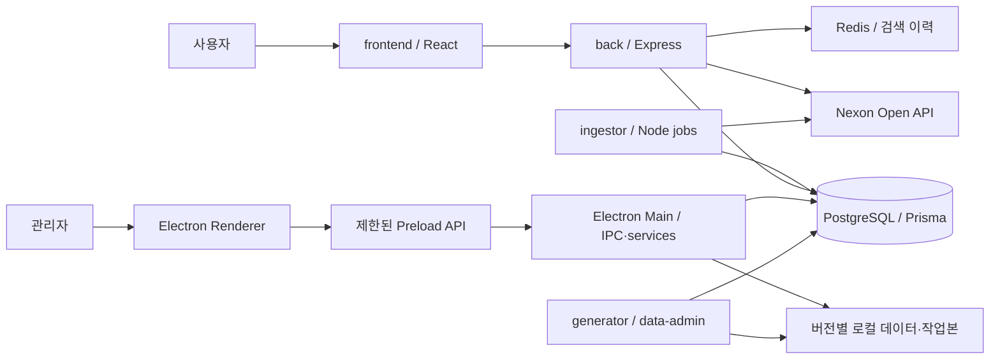

# 프로젝트와 아키텍처

## 풀려는 문제

Maple Insight는 메이플스토리 캐릭터 조회와 게임 데이터 분석을 목표로 하는 TypeScript 모노레포다. 외부 API 응답, 버전별 원본 게임 데이터, 직업·스킬 규칙, 캐릭터 수집 이력을 한 화면이나 한 DB 작업으로 합치면 출처와 검증 상태가 흐려진다. 이 저장소는 조회 서비스와 로컬 데이터 관리 도구를 분리하고, 그 사이의 타입·데이터·DB 책임을 패키지로 나눈다. 현재 공개 조회 서비스와 시뮬레이션은 완성 단계가 아니다. [프로젝트 소개](../../README.md), [전체 명세](../../SPEC.md).

## 현재 구성

이 도식은 **접속 경계**다. Electron의 편집 작업본을 DB에 승인 반영하는 전체 publish 흐름과 그 뒤의 생성 자동화는 아직 완료되지 않았다. `back → DB`는 검색 이력 등 현재 코드 경계를 뜻하며, 캐릭터 검색 응답의 주 데이터 원천은 Nexon API다. [검색 컨트롤러](../../apps/back/src/domain/character/character.controller.ts), [Electron IPC 등록](../../apps/electron/src/main/ipc/register.ts), [수집 기본 진입점](../../apps/ingestor/src/index.ts).

## 설계 경계

| 경계 | 현재 역할 | 설계 의도와 한계 |
| --- | --- | --- |
| `frontend ↔ back` | React Query 기반 닉네임 검색과 `/api/character/search` | 응답 계약, 특히 skill 형태를 확정하고 화면 필드를 더 연결해야 한다. |
| `back ↔ Nexon` | OCID 확인, 다수 캐릭터 endpoint 호출, mapper로 응답 구성 | API 실패 상태와 캐시 동작을 끝까지 검증해야 한다. |
| `ingestor ↔ DB` | 랭킹 raw page, OCID·캐릭터·유니온 작업, 계정 그룹 잡 | 기본 실행은 랭킹 전용이며 전체 파이프라인 스케줄·품질 검증은 남았다. |
| `Renderer ↔ Preload ↔ Main` | UI가 명명된 IPC 메서드로 파일·DB 작업 요청 | 로컬 파일·DB 접근은 Main 서비스에 집중된다. |
| `Main ↔ 작업본 ↔ DB` | import·validation·diff, 부분적 edit workbench | dry-run·승인 publish·그 뒤의 생성은 Electron Phase 05·06 대기다. |
| `packages` | 외부 raw 타입, 공유 계약, 정적 데이터, DB, 생성·계산 | 앱이 패키지 API를 소비한다. 패키지의 모든 기능이 제품 UI에 연결된 것은 아니다. |

## 기술과 구조상의 선택

- pnpm workspace와 Turborepo가 앱·패키지를 묶는다. [루트 package.json](../../package.json), [workspace 설정](../../pnpm-workspace.yaml).
- `@maple/api-*`는 Nexon 원본 응답 타입, `@maple/contracts`는 내부 정규화 계약을 담당한다. [타입 패키지](../../packages/api-types/README.md), [계약 소스](../../packages/contracts/domain/src/index.ts).
- `@maple/db`가 Prisma schema·repository·관리 API를 소유하고 `@maple/data-admin`은 명령 실행과 입력 경로를 담당한다. [DB 아키텍처](../../packages/database/db/docs/ARCHITECTURE.md).
- 게임 데이터는 `data-core` 등 작은 도메인 패키지로 나뉜다. `bootstrap → data-core → 나머지 데이터 패키지 → generator` 순서는 생성 파일과 빌드 사이 순환을 피하기 위한 선택이다. [패키지 빌드 설명](../../packages/README.md).

## 포트폴리오에서 보여줄 판단

가장 설명 가치가 큰 결정은 **원본 보존 → 검증 작업본 → 버전 비교 → 편집 작업본 → 승인 반영**이라는 단계별 신뢰 경계다. 앞의 import·validation·diff는 검증 기록이 있고, 편집은 부분 구현, 승인 반영과 생성은 후속 목표다. 이 차이를 시각적으로 구분하면 설계 사고와 현재 결과를 동시에 정확하게 전달할 수 있다. [Electron 로드맵](../../apps/electron/docs/ROADMAP.md), [Electron 현재 목표](../../apps/electron/docs/GOAL/README.md).
